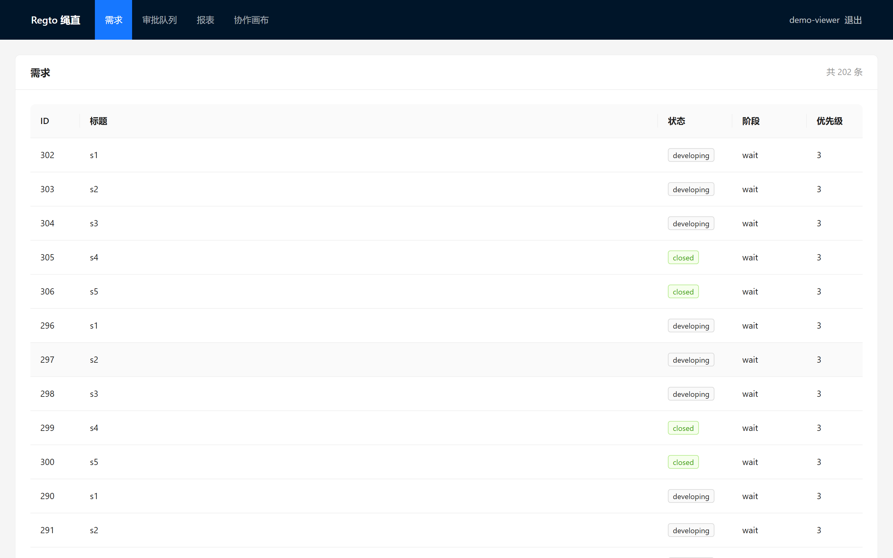
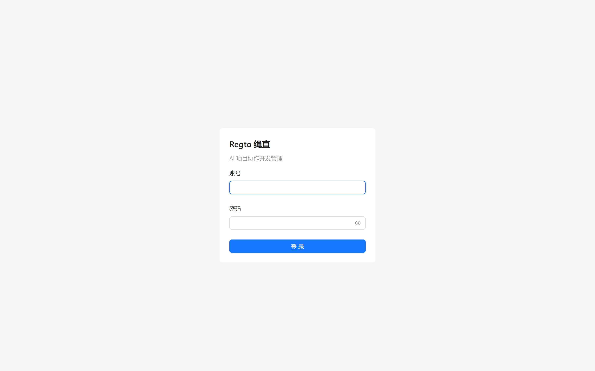
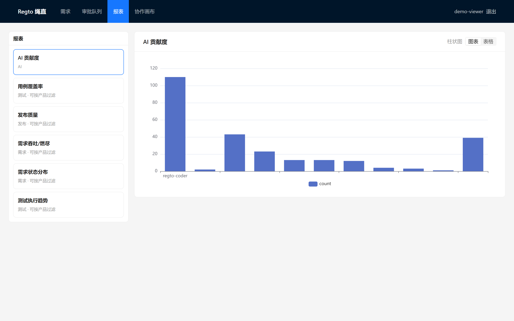
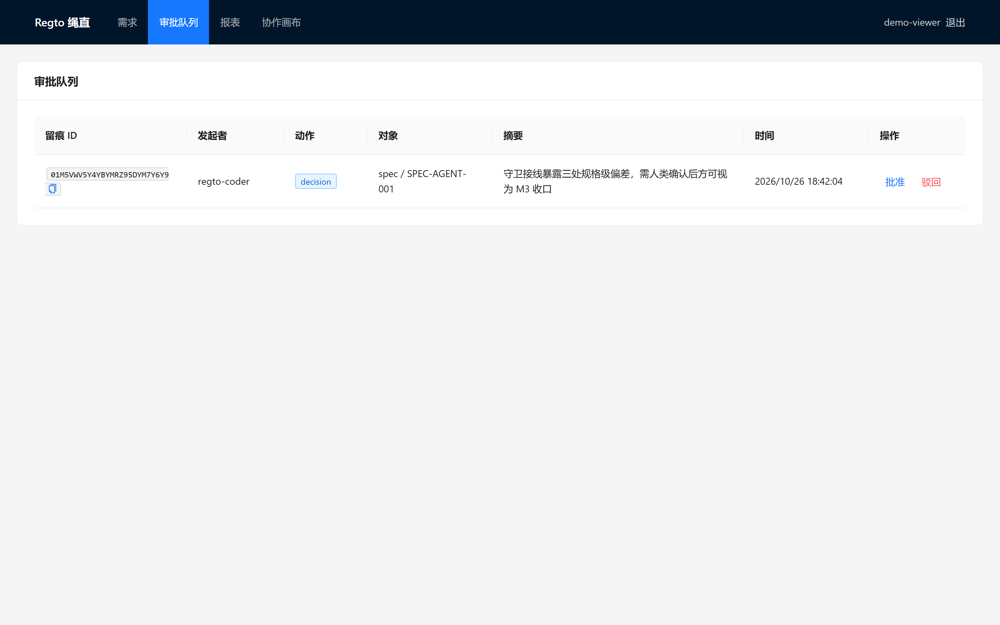
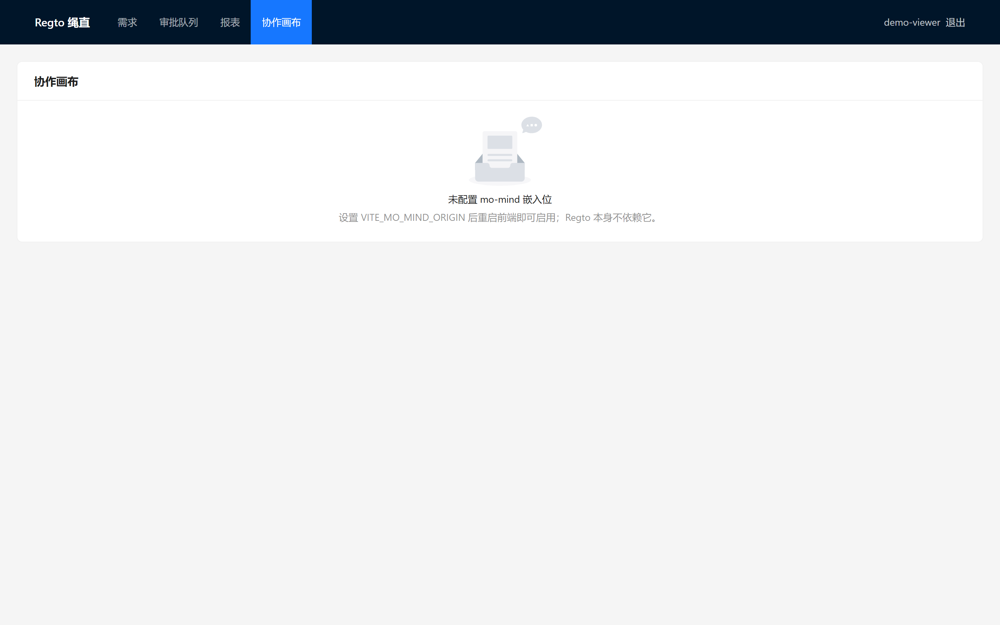

<div align="center">

# Regto（绳直）

**AI 项目协作开发管理系统 —— 规格先行 · 工作留痕 · 可审计**

<p>
  
  
  
  
  
  
</p>

<a href="#界面一览">界面一览</a> •
<a href="#这是什么">这是什么</a> •
<a href="#核心能力">核心能力</a> •
<a href="#快速开始">快速开始</a> •
<a href="#架构与目录">架构</a> •
<a href="#版本">版本</a> •
<a href="#公开范围与差异">公开范围</a> •
<a href="#许可">许可</a>

</div>



---

## 这是什么

Regto 是给**「人 + AI Agent 一起干活」的研发团队**用的项目管理系统。它把需求、设计、测试、代码串成可评审的规格链路，把每个实质动作写成带 hash 链的留痕，于是任何改动都能回答四个问题：谁做的、什么时候、为什么、证据在哪。

它解决三类问题：

- 让 AI 在**明确的权限边界**内自主开发——越权请求自动入队等待人类批准，批准即时生效；
- 把需求状态机从「口头约定」变成**非法转移一律 422**，并在响应里列出合法动作；
- 给既有项目补齐「AI 到底改了什么」的**审计链**（留痕表对应用账号物理只读，防篡改）。

领域词汇与状态机语义参考禅道 zentaopms 22.6，但**不是兼容实现**：没有复刻其 PHP 代码、模板与 API，而是用 Go 重新设计分层、契约与数据模型。详见 [NOTICE](./NOTICE)。

> **本仓库为 v1.0.0 公开版**：只包含可运行的产品代码子集，内部规格体系、工程文档、测试套件与本机运维脚本未随本仓库发布。见[公开范围与差异](#公开范围与差异)。

---

<a id="界面一览"></a>

## 界面一览

以下截图全部来自 **v1.0.0 的实际运行实例**（本地演示库数据，1440×900 @2x），前端产物由本仓库 `web/` 源码构建后经 `go:embed` 随二进制托管。

| 登录与认证 | 报表中心 |
| --- | --- |
|  |  |
| **AI 审批队列** | **协作画布嵌入位** |
|  |  |

四张图对应四个关键设计：httpOnly refresh cookie 的认证入口、六张业务报表的可视化、AI 越权留痕的人类审批闭环，以及「未配置 mo-mind 时零降级」的嵌入位占位。

---

<a id="核心能力"></a>

## 核心能力

| 领域 | 说明 |
| --- | --- |
| 需求与状态机 | 5 个主状态 + 9 个 stage + 评审四分支；所有动作收敛到 `POST /{resource}/{id}/transitions`，非法转移返回 `422 INVALID_TRANSITION` 并在 `meta` 中列出合法动作 |
| 用例与测试执行 | 用例 / 步骤 / 套件 + ZTF 导入导出；测试单、执行结果入库，`go test -json` 结果可映射回用例 |
| 发布管理 | 产品计划 / 发布 / 构建三段状态机，发布质量报表回答「这个版本测了多少、修了多少」 |
| 留痕与审计 | jsonl 追加真源 + sha256 hash 链 + 数据库只读副本；`traces` 对应用账号只有 SELECT / INSERT（迁移 000019 物理防篡改）；3 张审计报表 |
| AI 权限边界 | 能力白名单 + 审批策略双档；越权返回 `403` 并入审批队列，人类批准后即时生效；AI 置信度低于阈值必须停 |
| 账号与 RBAC | 5 角色 × 12 资源 × 4 动作矩阵，判定顺序为「能力白名单 → 物理约束 → 矩阵」；零角色不回落 guest |
| 报表 | 6 张业务报表 + 3 张审计报表，统一 `{data, page, links}` 信封 |
| Web 控制台 | React 18.3 + Vite + AntD 5 + ECharts：登录、需求、审批队列、报表、嵌入位；`go:embed` 进二进制，单文件部署 |
| Go SDK | `sdk/go` 零第三方依赖，`application/problem+json` 映射为可 `errors.Is` 的错误类型并保留业务码 |
| 存量导入 | 禅道数据三阶段游标导入、断点续跑与校验清单 |
| 运维 | 启动即校验 schema 版本，不匹配拒绝启动；生产禁止自动迁移；内置 `regtoctl bench` 压测入口 |

`api/openapi/v1.yaml` 是**接口契约唯一真源**（50 个路径），前端 TS 类型由它生成，CI 校验生成物零漂移。错误统一 RFC 7807，认证走 Bearer JWT（access 15m / refresh 7d，refresh 存 httpOnly cookie），AI / CI 走 `X-Regto-Api-Key`。

---

<a id="快速开始"></a>

## 快速开始

### 前置依赖

| 组件 | 版本 | 说明 |
| --- | --- | --- |
| Go | 1.25+ | 见 `go.mod` |
| PostgreSQL | 16 | 需要可建库 / 建角色的超级用户执行一次初始化 |
| Redis | 7.0 | 会话与 API Key 校验缓存 |
| Node.js | 20 / 22 | **仅构建 Web UI 需要**；不装也能编出后端二进制，但页面会返回 503 |

### 1. 建库与角色（一次性，超级用户执行）

```sql
-- 在默认库 postgres 中执行
CREATE DATABASE regto ENCODING 'UTF8' LC_COLLATE 'C' LC_CTYPE 'C' TEMPLATE template0;
CREATE ROLE regto_app LOGIN PASSWORD '<app-password>'
    NOSUPERUSER NOCREATEDB NOCREATEROLE NOINHERIT;
```

在 `regto` 库中执行迁移后，按最小权限原则给 `regto_app` 授权：业务表 `SELECT / INSERT / UPDATE`、**不给 DELETE / TRUNCATE / CREATE**；`traces` **只有 SELECT / INSERT**；`schema_migrations` 对应用账号零权限。

> ⚠️ 完整的逐表授权脚本未随公开版发布（属于内部部署文档）。请按上述原则自行配置，否则审计型权限模型不成立。迁移 `000019_traces_immutable.up.sql` 会在数据库侧再次收紧 `traces` 权限。

### 2. 配置

```bash
cp .env.example .env
# 编辑 .env：填数据库 / Redis 连接串与 ≥32 字节的 REGTO_AUTH_JWT_SECRET
mkdir -p traces          # 留痕 jsonl 真源目录
```

`.env` 已在本仓库 `.gitignore` 中，**切勿提交**。三条连接串各司其职：`REGTO_MIGRATION_URL`（超级用户，仅 `cmd/migrate`）、`REGTO_DATABASE_URL`（应用最小权限账号）、`REGTO_REDIS_URL`。

> `REGTO_AUTH_JWT_SECRET` 缺失或短于 32 字节时服务**拒绝启动**；非本地环境务必把 refresh cookie 置于 HTTPS。

### 3. 迁移与首个管理员

```bash
go run ./cmd/migrate up          # 应用内嵌迁移（当前 v22）
go run ./cmd/regtoctl schema     # 断言 schema_migrations == schema_meta
go run ./cmd/regtoctl account init-admin --account admin --password '<强密码>'
```

> 不初始化管理员时，`REGTO_ACL_MODE=enforce` 下所有人类请求都是 403。

### 4. 构建前端（干净克隆必做）

```bash
make web-init       # 安装 web/ 依赖
make web-build      # 构建并把产物同步进 internal/adapter/http/webui/dist
make build          # 产出 bin/regto-server 与 bin/regtoctl（含 go:embed 前端）
```

`go:embed` 只能引用本包目录，因此 `webui/dist` 只提交占位文件；**未构建前端时二进制能编译，但页面返回 503 并提示先执行 `make web-build`**。`make build` 在检测到 `web/node_modules` 时会自动调用 `web-build`。

### 5. 启动与验证

```bash
go run ./cmd/regto-server        # 默认 127.0.0.1:8080，API 与 Web 同源
curl -s http://127.0.0.1:8080/healthz    # {"status":"ok"}
curl -s http://127.0.0.1:8080/readyz     # {"postgres":"ok","redis":"ok"}
```

浏览器打开 `http://127.0.0.1:8080/login`，用第 3 步的账号登录。

第一次调用 API：

```bash
API=http://127.0.0.1:8080/api/v1
TOKEN=$(curl -s -X POST $API/auth/login -H 'Content-Type: application/json' \
  -d '{"account":"admin","password":"<强密码>"}' \
  | sed -n 's/.*"access_token":"\([^"]*\)".*/\1/p')

curl -s -X POST $API/stories \
  -H "Authorization: Bearer $TOKEN" -H 'Content-Type: application/json' \
  -d '{"product_id":1,"title":"需求A","spec":"描述","verify":"验收","reviewers":[1],"as_draft":true}'

curl -s -X POST $API/stories/1/transitions \
  -H "Authorization: Bearer $TOKEN" -H 'Content-Type: application/json' \
  -d '{"action":"submitReview","comment":"提交评审"}'
```

> 动作名固定：`submitReview / reviewPass / reviewClarify / reviewRevert / reviewReject / activate / change / close`。

---

<a id="架构与目录"></a>

## 架构与目录

依赖单向：`cmd → adapter/http → usecase → domain ← adapter/persistence`，事务边界在 usecase，领域层零外部依赖，审计统一收敛在 usecase 层。

| 位置 | 职责 |
| --- | --- |
| `cmd/regto-server` | HTTP 服务装配、中间件、守卫、schema 自检 |
| `cmd/regtoctl` | 运维与规格 CLI：`spec` / `trace` / `schema` / `account` / `bench` 及业务域命令 |
| `cmd/migrate`、`cmd/import-zentao` | 迁移执行器、禅道存量导入器 |
| `internal/domain/` | 纯领域逻辑：状态机、ACL、能力白名单、留痕判定 |
| `internal/usecase/` | 编排、事务边界、审计 |
| `internal/adapter/http/` | chi 路由、handler、DTO、RFC 7807 映射、嵌入的 `webui` |
| `internal/adapter/persistence/` | pgx 仓储实现 |
| `internal/platform/` | id(ULID) / clock / config / db / redis / log / authn，零业务语义 |
| `api/openapi/v1.yaml` | 接口契约唯一真源 |
| `migrations/` | 22 个版本、`%06d_<scope>_<verb>.{up,down}.sql` |
| `sdk/go/` | 官方 Go 客户端（零第三方依赖） |
| `web/` | React 控制台源码（登录 / 需求 / 审批队列 / 报表 / 嵌入位） |
| `screenshots/` | 本 README 引用的 v1.0.0 运行截图 |

干净克隆的自检：`make check`（gofmt / vet / build）、`make web-check`（契约生成一致性 / lint / typecheck / 构建），或直接 `go build ./...` 与 `cd web && npm ci && npm run build`。

---

<a id="版本"></a>

## 版本

| 位置 | 值 |
| --- | --- |
| Release tag | `v1.0.0` |
| `api/openapi/v1.yaml` → `info.version` | `1.0.0` |
| `web/package.json` → `version` | `1.0.0` |
| `regtoctl version` | `1.0.0`（可由 `-ldflags -X main.version=...` 覆盖） |
| 数据库 schema | v22（由内嵌迁移决定，**不通过环境变量配置**） |

验证：`go run ./cmd/regtoctl version` → `regtoctl 1.0.0`。

---

<a id="公开范围与差异"></a>

## 公开范围与差异

本仓库是**可独立编译运行的产品代码子集**。以下内容按发布要求未纳入：

| 未包含 | 影响 |
| --- | --- |
| `spec/`（规格三件套、登记表、路线图） | SpecDD 追溯链与 `spec lint --strict` 闸门在公开版不可用；代码注释中的规格编号仅作溯源线索 |
| `docs/`（部署、评审、演练、压测记录） | 数据库初始化与权限授权脚本需自行按上文原则配置 |
| `tests/`（Go 单元 / 集成 / golden，以及前端单测与 e2e） | CI 不含覆盖率闸门；公开版不提供自动化测试套件 |
| `traces/`（本地留痕 jsonl 真源） | 干净安装从空目录开始写留痕 |
| 本机运维脚本、本地配置、CI 与构建产物 | 不含 `.env`、`node_modules/`、`web/dist/`、`bin/`、`regtoctl.exe`、覆盖率报告与 GitHub Actions 工作流配置（用 `make check` / `make web-check` 本地自检） |

发布前已做敏感信息扫描（令牌、内网地址、本机绝对路径、明文口令、私钥、个人信息），并对少量内部账号示例做了中性化处理。

### 仍待处理

1. **许可溯源审计**：禅道为 ZPL 1.2 / AGPL 双授权，Regto 定性为「语义参考 + 重新设计」，正式商用或再分发前请完成溯源审计并咨询专业人士；本项目不提供法律意见。
2. **部署脚本公开化**：最小权限授权脚本尚未以可复用形式发布。
3. **测试体系公开化**：`go test -race`、覆盖率 ≥90% 闸门与 SpecDD 追溯矩阵仍只在内部仓库可用。
4. **关联项目**：mo-mind（协作画布内核）、AgentTodoList（外部执行源）尚未同步开源；嵌入位与联动默认关闭，Regto 单独运行零降级。
5. **M1–M6 整体验收**：人类走查清单尚待签署；后续里程碑（外部执行源、协作画布联动）仍处规划阶段。

---

<a id="许可"></a>

## 许可

**Apache-2.0**，见 [LICENSE](./LICENSE) 与 [NOTICE](./NOTICE)。

<div align="center">

规格先行 · 工作留痕 · 可审计

让 AI 在边界内自主开发，让每一个改动都找得到出处。

</div>
